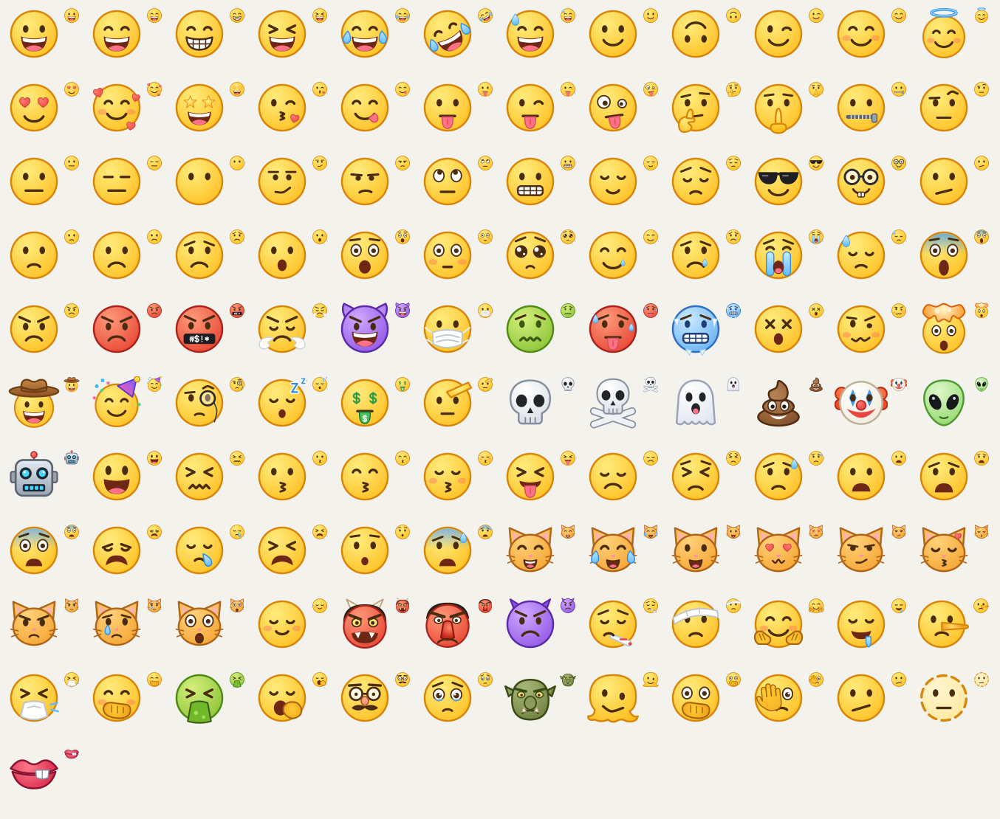
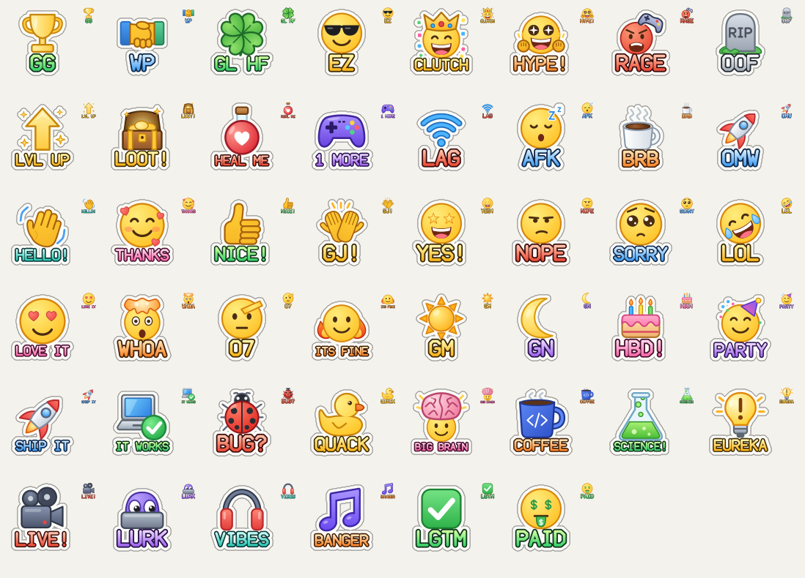
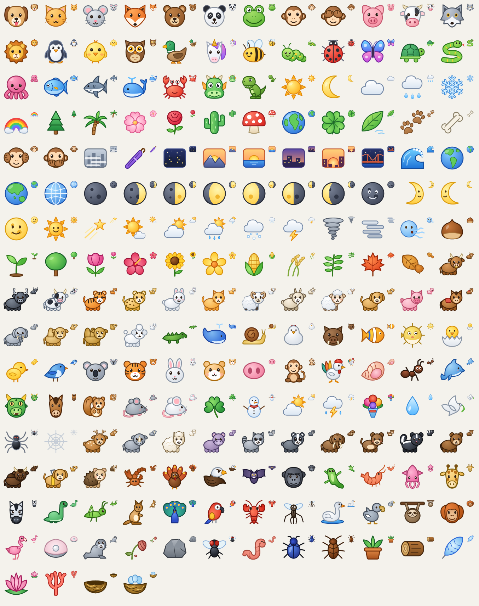

# Remedy Emoji

Our own emoji and stickers: 1,670 emoji in 14 categories and 46 stickers, all original art.
Every standard single emoji is drawn (1,386), plus 284 of our own.
No emoji font and no third-party image set. First drawn for FreeSpeak.

Each glyph is a few lines of text in a small vector format (`.fsa`) and is drawn by the
rasterizer in this crate. The crate has no dependencies.

- Nothing in a glyph is executed, and it cannot name a file or a URL.
- No image decoder runs on a sticker that came from someone else: the reader has hard
  limits on source size, shapes and points.
- A glyph draws sharply at any size, from a 20 pixel chat line to a 160 pixel sticker.
- Six skin tones, chosen when drawing.

## Gallery

Smileys, the built-in sticker pack, and nature, drawn at 72 pixels (the sticker sheet at 96):







Each sheet is a plain contact sheet from the crate's `sheet` example, so you can redraw it
any time (see [The art](#the-art) below).

## Use

There are three ways in, all from the same art.

### The font (any app, any language)

`fonts/RemedyEmoji.ttf` (and `.woff2` for the web) is a color font, family **Remedy Emoji**.

- The 1,386 emoji that have a Unicode code point are at that code point, so plain text
  with emoji in it just works: `font-family: "Remedy Emoji"` after your text font.
- Skin tones follow Unicode: the emoji, then U+1F3FB to U+1F3FF.
- The 330 glyphs of our own (stickers included) are in the private use area, plane 15.
  Their code points are in `font/codepoints.txt` and never change once given.

It is a COLRv1 font (layers with gradients). RemedyUI, Chrome, Edge, Firefox, Android and
Windows 11 draw it; Safari and Apple's text system do not draw COLRv1 fonts yet.

### The list (pickers, search, shortcodes)

`fonts/RemedyEmoji.json` has every glyph: `name` (its `:name:` shortcode), `kind` (emoji or
sticker), `category`, `keywords`, `text` (the characters to put in a string), `codepoints`,
`unicode` (false for our own glyphs) and `tones`.

### The Rust crate (draws without a font)

```toml
[dependencies]
remedy-emoji = { git = "https://github.com/AhmiDarrow/RemedyEmoji" }
```

```rust
let lib = remedy_emoji::builtin();
if let Some(glyph) = lib.by_name("grinning") {
    // 64 x 64 pixels, default skin tone; `image.rgba` is width * height * 4 bytes.
    let image = remedy_emoji::render(glyph, 64, 0);
}
// Split a chat line into text and glyphs (Unicode emoji and `:name:` shortcodes).
let parts = lib.segments("well done :gg: 👍");
```

`Library` also has the picker's needs: `categories`, `search`, `complete`, and
`parse_sticker` for a sticker received from someone else (the crate reads art that
arrives at run time; the font holds only the built-in set).

## The art

- `art/parts.fsa`: shared colours and reusable pieces (the face, eyes, a heart, a star).
- `art/emoji/*.fsa`: one sheet per picker category.
- `art/stickers/*.fsa`: the built-in sticker pack.

The format is described in [docs/emoji.md](docs/emoji.md). To look at the art, draw a
contact sheet:

```
cargo run --example sheet -- sheet.png --px 96 --cols 8
```

## Build and check

Most sheets in `art/emoji/` are written by hand. Three are written by scripts in `art/`
(`gen_shapes3.py` for the patterned symbols, `gen_animals2.py` for the four-legged animals);
change those there and run the script.

After changing the art, rebuild the font and commit it with the art:

```
cargo test
cargo run --release --example export -- target/art.json
python font/build.py && python font/check.py
```

`build.py` needs fontTools, skia-pathops and brotli. The same art gives the same bytes.

## License

MIT or Apache-2.0, at your option, for the code and the art.
